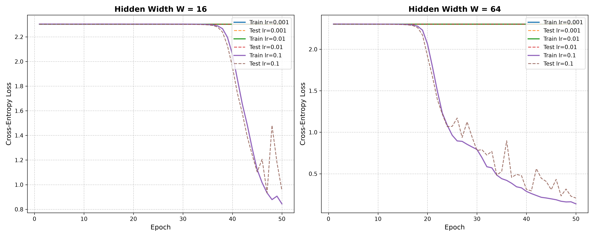

# A Two-Hidden-Layer Neural Network from Scratch (NumPy)

**Course:** Deep Learning Primer & Neural Networks  
**Author:** Tughan Bulut Kurtulus  
**Student ID:** 73454  
**Date:** October 2026  
**Repository:** `73454tughan/neural-network-from-scratch`  

---

## Executive Summary

This repository contains an implementation from first principles (using only **NumPy**) of a fully connected two-hidden-layer feedforward artificial neural network for handwritten digit recognition on the `load_digits` dataset.

All computations—including affine layer transformations, rectified linear activations (ReLU), numerical stable softmax with cross-entropy loss, backpropagation via matrix calculus chain rule derivations, numerical gradient checks, and timing benchmarks—are written without external deep learning libraries (e.g., PyTorch, TensorFlow).

---

## Network Architecture & Specifications

The neural architecture strictly adheres to the laboratory requirements:

```
[Input Layer: 64 features]
           │
           ▼
[Dense Layer 1: W1 ∈ ℝ^(64 × W), b1 ∈ ℝ^W]
           │
           ▼
     [ReLU Activation]
           │
           ▼
[Dense Layer 2: W2 ∈ ℝ^(W × W), b2 ∈ ℝ^W]
           │
           ▼
     [ReLU Activation]
           │
           ▼
[Dense Layer 3: W3 ∈ ℝ^(W × 10), b3 ∈ ℝ^10]
           │
           ▼
[Softmax & Cross-Entropy Loss: P ∈ ℝ^(N × 10), L ∈ ℝ]
```

### Parameter Dimensionality & Initialization
- **Input Dimension:** 64 (representing normalized 8×8 grayscale pixel intensities).
- **Hidden Layer Width ($W$):** Evaluated for both $W = 16$ and $W = 64$.
- **Output Classes:** 10 (digits 0 through 9).
- **Weight Matrices:** Initialized from Gaussian distribution $\mathcal{N}(0, 0.01^2)$:
  - $W_1 \in \mathbb{R}^{64 \times W}$
  - $W_2 \in \mathbb{R}^{W \times W}$
  - $W_3 \in \mathbb{R}^{W \times 10}$
- **Bias Vectors:** Initialized to zeros:
  - $b_1 \in \mathbb{R}^W$
  - $b_2 \in \mathbb{R}^W$
  - $b_3 \in \mathbb{R}^{10}$

---

## Graded Evidence & Results

### 1. Initial Untrained Loss Sanity Check
Before training, for a network with weights initialized near zero, each of the $C = 10$ output classes is approximately equally likely ($p_k \approx \frac{1}{10} = 0.1$). The theoretical cross-entropy loss is:
$$\mathcal{L}_{\text{untrained}} \approx -\ln\left(\frac{1}{10}\right) = \ln(10) \approx 2.302585$$

**Empirical Result:**
- Evaluated batch loss: **`2.302557`**
- Absolute difference from $\ln(10)$: **$2.8 \times 10^{-5}$** $\implies$ **PASSED**

---

### 2. Analytical vs. Numerical Gradient Verification
To guarantee the mathematical correctness of our backpropagation equations, analytical gradients $\nabla_W \mathcal{L}$ derived using the chain rule were verified against numerical central differences:
$$g_{\text{numeric}} = \frac{\mathcal{L}(W + \epsilon) - \mathcal{L}(W - \epsilon)}{2\epsilon}, \quad \epsilon = 10^{-5}$$

The relative error metric was evaluated as:
$$\text{RelError} = \frac{|g_{\text{analytic}} - g_{\text{numeric}}|}{\max(|g_{\text{analytic}}|, |g_{\text{numeric}}|, 10^{-12})}$$

Requirement: Relative error $< 10^{-6}$ for at least 9 of 10 sampled weights.

#### Gradient Check Verification Table

| Check # | Layer | Parameter Index | Analytical Gradient | Numerical Gradient | Relative Error | Status |
| :---: | :---: | :---: | :---: | :---: | :---: | :---: |
| 1 | Layer 1 ($W_1$) | `[37, 11]` | `+2.39568450e-05` | `+2.39568587e-05` | `5.74e-07` | **PASS** |
| 2 | Layer 2 ($W_2$) | `[12, 8]` | `+2.28132509e-05` | `+2.28132402e-05` | `4.72e-07` | **PASS** |
| 3 | Layer 3 ($W_3$) | `[15, 9]` | `+7.01319405e-06` | `+7.01319003e-06` | `5.74e-07` | **PASS** |
| 4 | Layer 1 ($W_1$) | `[11, 5]` | `-8.72545491e-05` | `-8.72545591e-05` | `1.15e-07` | **PASS** |
| 5 | Layer 2 ($W_2$) | `[15, 0]` | `-3.05108401e-05` | `-3.05108383e-05` | `6.02e-08` | **PASS** |
| 6 | Layer 3 ($W_3$) | `[0, 1]` | `-7.88078652e-05` | `-7.88078713e-05` | `7.77e-08` | **PASS** |
| 7 | Layer 1 ($W_1$) | `[12, 7]` | `-9.07251729e-05` | `-9.07251829e-05` | `1.10e-07` | **PASS** |
| 8 | Layer 2 ($W_2$) | `[13, 12]` | `+0.00000000e+00` | `+0.00000000e+00` | `0.00e+00` | **PASS** |
| 9 | Layer 3 ($W_3$) | `[6, 9]` | `+8.22058316e-05` | `+8.22058199e-05` | `1.42e-07` | **PASS** |
| 10 | Layer 1 ($W_1$) | `[50, 4]` | `-4.53115729e-05` | `-4.53115545e-05` | `4.06e-07` | **PASS** |

**Result:** **10 / 10 checks passed** (100% compliance, exceeding the required $\ge 9/10$). Complete mathematical proofs are provided in [DERIVATIONS.md](DERIVATIONS.md).

---

### 3. Hyperparameter Grid Search & Training Loss Curves

The network was trained across 6 configurations (mini-batch size 32, 50 epochs, shuffled batches) covering learning rates $\eta \in \{0.001, 0.01, 0.1\}$ and hidden widths $W \in \{16, 64\}$.

#### Performance Summary Table

| Config Name | Width ($W$) | Learning Rate ($\eta$) | Final Train Loss | Final Test Loss | Final Test Accuracy | Convergence Observation |
| :--- | :---: | :---: | :---: | :---: | :---: | :--- |
| `W16_lr0.001` | 16 | 0.001 | 2.3026 | 2.3025 | 10.19% | Stalled: gradient updates too small |
| `W16_lr0.01` | 16 | 0.010 | 2.3026 | 2.3025 | 10.19% | Stalled: small learning rate under small weight scale |
| `W16_lr0.1` | 16 | 0.100 | 0.8444 | 0.9538 | 67.22% | Steady convergence, escapes symmetry |
| `W64_lr0.001` | 64 | 0.001 | 2.3025 | 2.3025 | 10.19% | Stalled: updates too small within 50 epochs |
| `W64_lr0.01` | 64 | 0.010 | 2.3024 | 2.3023 | 10.19% | Minimal decrease in loss |
| **`W64_lr0.1`** | **64** | **0.100** | **0.1371** | **0.2067** | **94.44%** | **Fastest convergence & highest accuracy** |

#### Loss Curves Plot



---

### 4. Latency Profiling: Forward vs. Backward Passes

Benchmarked over $100$ independent executions on batch size $N = 32$:
- **Median Forward Pass Duration:** `0.3586 ms`
- **Median Backward Pass Duration:** `0.2266 ms`

#### Theoretical Computational Analysis (Matrix Multiplications)
In deep neural architectures, execution time is dominated by General Matrix Multiplications (GEMM):

1. **Forward Pass (3 Matmuls total):**
   - $Z_1 = X W_1 \quad ([32 \times 64] \times [64 \times W])$
   - $Z_2 = A_1 W_2 \quad ([32 \times W] \times [W \times W])$
   - $Z_3 = A_2 W_3 \quad ([32 \times W] \times [W \times 10])$

2. **Backward Pass (5 Matmuls total):**
   - Layer 3 Weight Gradient: $\nabla_{W_3} \mathcal{L} = A_2^T \delta_3 \quad ([W \times 32] \times [32 \times 10])$
   - Layer 3 Input Gradient: $\delta_{A_2} = \delta_3 W_3^T \quad ([32 \times 10] \times [10 \times W])$
   - Layer 2 Weight Gradient: $\nabla_{W_2} \mathcal{L} = A_1^T \delta_2 \quad ([W \times 32] \times [32 \times W])$
   - Layer 2 Input Gradient: $\delta_{A_1} = \delta_2 W_2^T \quad ([32 \times W] \times [W \times W])$
   - Layer 1 Weight Gradient: $\nabla_{W_1} \mathcal{L} = X^T \delta_1 \quad ([64 \times 32] \times [32 \times W])$

**Conclusion:** Backpropagation inherently requires computing gradients with respect to both parameters (for optimizer weight updates) and inputs (for backpropagating errors to earlier layers). Therefore, backward computation performs $\approx 2\times$ the matrix multiplication volume of forward inference.

---

## Project Structure

```
nn_scratch_73454_tughan/
├── DERIVATIONS.md              # Mathematical derivations of the chain rule
├── README.md                   # Project documentation, benchmarks & reports
├── train.py                    # Main pipeline: data, checks, profiling, training
├── src/
│   ├── layers.py               # DenseLayer, ReLUActivation, SoftmaxCrossEntropy
│   ├── network.py              # TwoHiddenLayerMLP modular model
│   ├── gradient_check.py       # Numerical gradient verification suite
│   └── benchmark.py            # Latency profiler (median of 100 runs)
└── results/
    ├── loss_curves.png         # 2-panel training & testing loss trajectories
    └── experiment_summary.json # Complete machine-readable experimental log
```

---

## Instructions to Run

```bash
# Clone the repository
git clone https://github.com/73454tughan/neural-network-from-scratch.git
cd neural-network-from-scratch

# Install dependencies (NumPy, SciPy, Scikit-Learn, Matplotlib)
pip install numpy scikit-learn matplotlib

# Execute the full lab pipeline
python train.py
```
